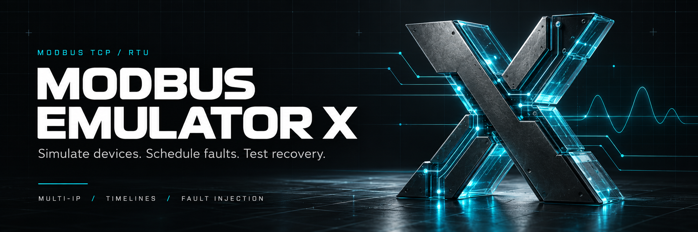
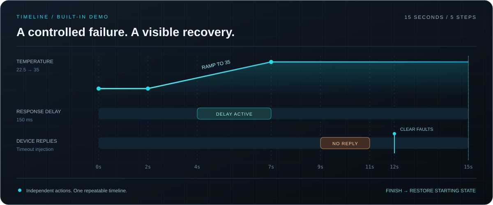

<p align="center">
  
</p>

<p align="center">
  <strong>A multi-IP Modbus TCP/RTU emulator. Built for deliberate failure.</strong><br>
  Configure devices, orchestrate timed faults, and test how your SCADA responds.
</p>

<p align="center">
  
  
  
  
</p>

<p align="center">
  <a href="#capabilities">Capabilities</a> &nbsp; / &nbsp;
  <a href="#timelines">Timelines</a> &nbsp; / &nbsp;
  <a href="#quick-start">Quick start</a> &nbsp; / &nbsp;
  <a href="#development">Development</a>
</p>

---

## Capabilities

<table>
<tr>
<td width="33%" valign="top">

### 01 / EMULATE

Multiple IPv4 addresses, TCP ports and unit IDs. Serial RTU with configurable baud rate, parity and stop bits.

</td>
<td width="33%" valign="top">

### 02 / DISRUPT

Timeouts, response delays, request loss and Modbus exceptions. Schedule temporary faults with automatic recovery.

</td>
<td width="33%" valign="top">

### 03 / OBSERVE

Live values, signal generation, trends and traffic inspection. Export timeline events for review.

</td>
</tr>
</table>

| Interface | Technical scope |
|:---|:---|
| **Register map** | Coils, discrete inputs, holding registers and input registers; zero-based addressing. |
| **Value encoding** | Bool, UInt16, Int16, UInt32, Int32 and Float32. Scaling, offsets and byte/word swapping. |
| **Signal modes** | Manual, sine, ramp, random and toggle. |
| **Project files** | `.MBX` native projects and editable `.XLSX` imports/exports retain timelines. `.CSV` carries devices and points only. |
| **Network setup** | Temporary local IP aliases on a selected adapter; administrator approval required. |

## Timelines



**Scheduled changes. Concurrent devices. Repeatable recovery.**

Create timed value changes and gradual ramps, combine independent faults, and repeat entire sequences. Pause/resume playback, restore the starting state, or retain the final state on completion.

> **Playback:** approximately 250 ms updates, not hard real-time. Pause holds current faults active. Stop always restores starting values and faults; each repeat begins from the original state.

## Quick start

1. Extract the application package and run **`ModbusEmulatorX.exe`**.
2. Open the demo or configure your devices and points.
3. Click **Start servers**, then connect your SCADA or Modbus master.
4. Open **Scenarios & faults** and run the included demo timeline.

```text
DEMO ENDPOINT    127.0.0.1:1502
UNIT ID         1
ADDRESSING      Zero-based
WRITES          Disabled by default
```

Use an isolated test network when preparing additional IP addresses.

## Development

**C# · Windows Forms · .NET Framework 4.8**

Open `ModbusEmulatorX.sln` in Rider or Visual Studio with the **4.8 Developer Pack** installed.

```powershell
.\Build.cmd -RunTests
```

**Release 1.3.0: 190 automated checks passed.** Coverage includes live TCP transactions, protocol handling, timeline execution, project round-trips, network planning and headless UI regressions. Physical RTU hardware and visual UI testing were not performed.

---

<p align="center">
  <strong>MODBUS EMULATOR X</strong><br>
  <sub>ENGINEER THE CONDITIONS. OBSERVE THE RESPONSE.</sub>
</p>
<p align="right"><sub>William Keay · 2026</sub></p>
